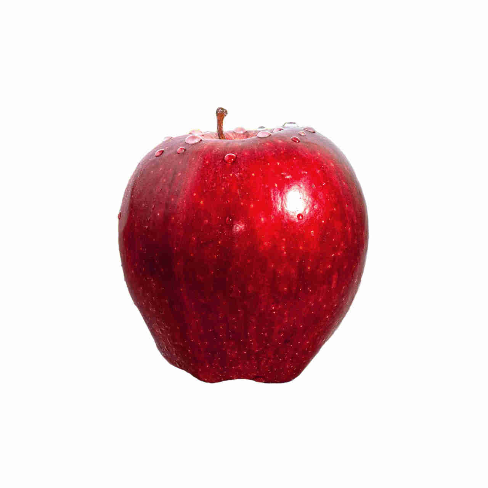
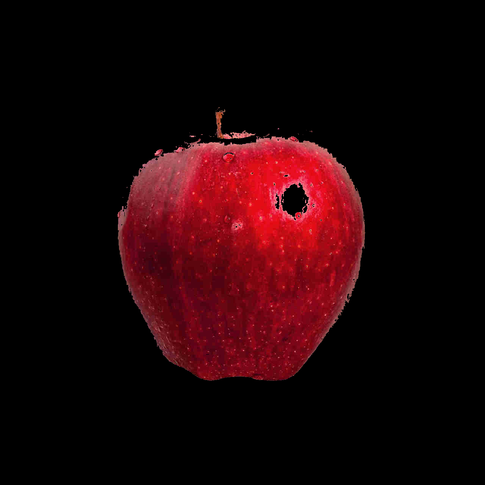

# Image Processing with Python and OpenCV

## Overview

## Overview

This repository contains practical image processing studies using Python and OpenCV, focusing on HSV-based color detection, image masking, and research on Canny edge detection.

These studies were carried out as part of STNM student community activities at Fırat University.

## Technologies

- Python
- OpenCV
- HSV Color Space
- Image Masking
- Bitwise Operations

## Red Color Detection

The application detects red regions in an image using HSV color thresholds and masking techniques.

### Pen Detection

| Original Image | Binary Mask | Detection Result |
| :---: | :---: | :---: |
|  |  |  |

### Apple Detection

The following images show the results of an earlier color detection experiment.

| Original Image | Binary Mask | Detection Result |
| :---: | :---: | :---: |
|  |  |  |

## Canny Edge Detection

A theoretical research study covering the Canny edge detection algorithm, its processing stages, applications, advantages and limitations.

## Installation

Install the required library:

```bash
python -m pip install -r requirements.txt
```

## Usage

Run the application from the project directory:

```bash
python app.py
```

The current application processes the pen image and displays the original image, binary mask and detection result.

## Documentation

Research and application reports are available in the [reports](reports/) directory.
